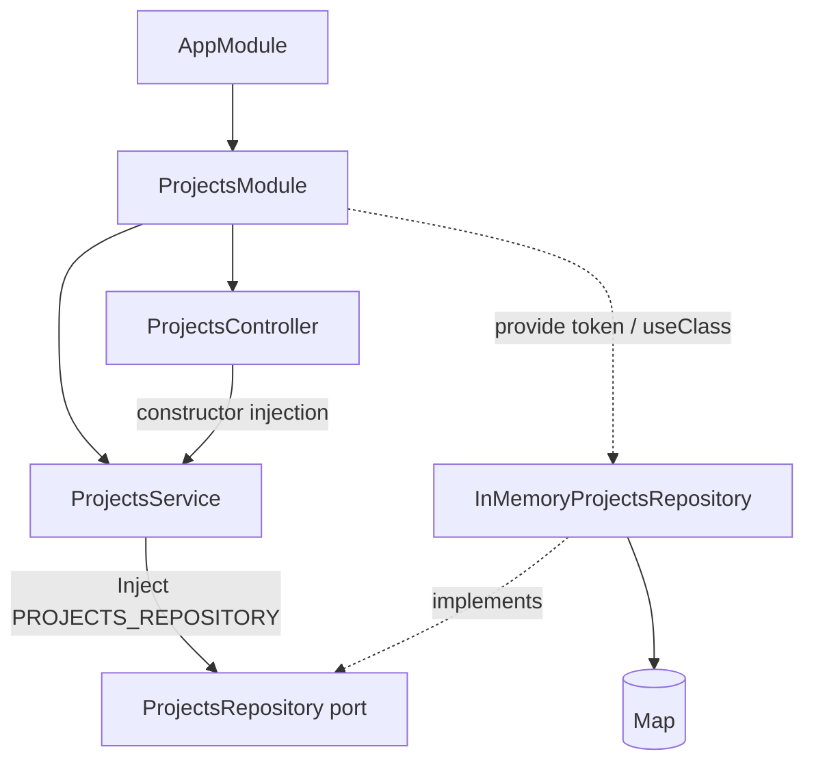

# ПР 3. Модулі, controllers, providers і dependency injection

Вертикальний зріз **Projects** на NestJS та TypeScript: HTTP → application service → repository port → in-memory adapter.

## Запуск

Потрібні Node.js 20+ та npm.

```sh
npm ci
npm run build
npm start
```

API доступне за адресою `http://localhost:3000/projects`. Порт можна змінити змінною середовища `PORT`.
Для запуску TypeScript напряму: `npm run start:dev`.

## Розподіл відповідальності

| Компонент | Відповідальність |
| --- | --- |
| `ProjectsModule` | Реєструє контролер, сервіс і прив’язку DI-токена до repository adapter; експортує сервіс. |
| `ProjectsController` | Описує HTTP-маршрути, приймає DTO та UUID, викликає сервіс. Не містить persistence чи бізнес-правил. |
| `ProjectsService` | Реалізує create, findAll, findOne, update, remove; нормалізує назву й опис, створює UUID та часові мітки, перевіряє порожнє оновлення й відсутність проєкту. |
| `ProjectsRepository` | Port: асинхронний CRUD-контракт, незалежний від конкретного сховища. |
| `InMemoryProjectsRepository` | Adapter: зберігає записи в Map та повертає копії об’єктів. |
| DTO + `ValidationPipe` | Перевіряють форму HTTP-запиту, типи, довжину рядків і забороняють зайві поля. |

## Dependency graph



Текстова схема: `ProjectsController → ProjectsService → ProjectsRepository ← InMemoryProjectsRepository → Map`.

TypeScript interface не існує під час виконання, тому port має runtime-токен `PROJECTS_REPOSITORY` типу Symbol. Модуль зв’язує його з адаптером:

```ts
{ provide: PROJECTS_REPOSITORY, useClass: InMemoryProjectsRepository }
```

Сервіс отримує залежність через `@Inject(PROJECTS_REPOSITORY)`. Для переходу на БД достатньо створити адаптер, що реалізує `ProjectsRepository`, і змінити `useClass` у модулі. Controller та service не залежать від Map. У тесті адаптер підміняється через `overrideProvider(...).useValue(fake)`.

## Модель і правила

Проєкт має `id` (UUID v4), `name`, `description`, `createdAt`, `updatedAt` (ISO 8601).

- `name` — обов’язковий рядок у POST, максимум 120 символів; має містити непробільний символ.
- `description` — необов’язковий рядок, максимум 2000 символів, за замовчуванням `""`.
- Сервіс прибирає пробіли на початку й у кінці назви та опису.
- PATCH змінює лише передані поля, зберігає `id` і `createdAt`; `{}` відхиляється. `description: ""` очищає опис.
- `null`, неправильні типи й невідомі поля відхиляються; UUID перевіряється HTTP pipe.
- Невідомий коректний UUID повертає 404 для GET, PATCH і DELETE.

**Зберігання навчальне:** дані живуть у пам’яті одного процесу й зникають після перезапуску. База даних не потрібна.

## CRUD API

| Метод | Маршрут | Операція | Успішна відповідь |
| --- | --- | --- | --- |
| POST | `/projects` | create | 201 + проєкт |
| GET | `/projects` | findAll | 200 + масив |
| GET | `/projects/:id` | findOne | 200 + проєкт |
| PATCH | `/projects/:id` | update | 200 + оновлений проєкт |
| DELETE | `/projects/:id` | remove | 204 без тіла |

Помилки: 400 — невалідний запит; 404 — проєкт не знайдено.

### Приклад у PowerShell

Запустіть сервер, а потім виконайте в іншому терміналі:

```powershell
$baseUrl = 'http://localhost:3000/projects'
$project = Invoke-RestMethod -Method Post -Uri $baseUrl -ContentType 'application/json; charset=utf-8' -Body '{"name":"PR 3","description":"NestJS CRUD"}'
Invoke-RestMethod -Uri $baseUrl
Invoke-RestMethod -Uri "$baseUrl/$($project.id)"
Invoke-RestMethod -Method Patch -Uri "$baseUrl/$($project.id)" -ContentType 'application/json' -Body '{"name":"Updated project"}'
Invoke-RestMethod -Method Delete -Uri "$baseUrl/$($project.id)"
```

## Структура

```text
src/
  main.ts
  app.module.ts
  configure-app.ts
  projects/
    project.ts
    projects.module.ts
    projects.controller.ts
    projects.service.ts
    dto/
      create-project.dto.ts
      update-project.dto.ts
    ports/
      projects.repository.ts
    repositories/
      in-memory-projects.repository.ts
test/
  projects.test.cjs
```

## Перевірка

```sh
npm test
```

Команда компілює TypeScript і запускає Node.js test runner. Тести перевіряють повний HTTP CRUD-цикл, часткове оновлення, незалежність записів, валідацію, відповіді 400/404, підміну port через Nest DI і захист сховища від мутацій повернутих об’єктів. HTTP-тести використовують тимчасовий локальний порт і закривають сервер після завершення.
